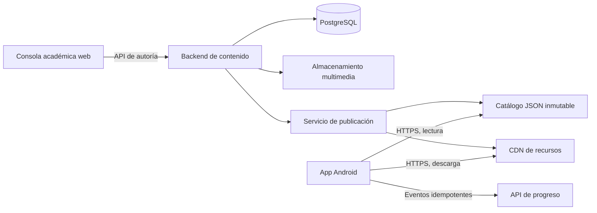
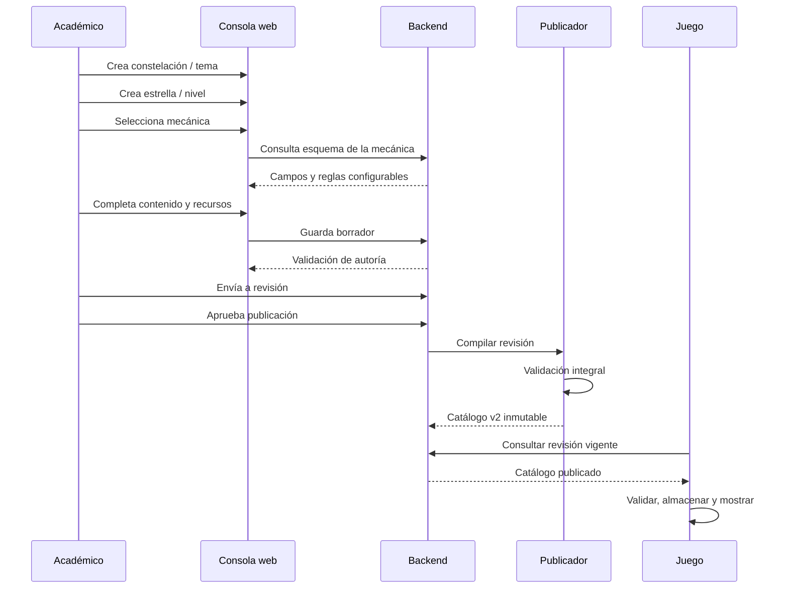

# Integración de la consola académica con Caza Estelar

Estado: propuesta técnica para implementación  
Fecha: 19 de agosto de 2026  
Responsable funcional: equipo académico  
Responsable técnico: equipo de Caza Estelar

## 1. Objetivo

Conectar una consola web externa con el juego Android para que el equipo académico pueda crear, revisar y publicar contenido matemático sin modificar ni recompilar la aplicación.

La separación de responsabilidades será:

- El equipo de desarrollo programa y versiona las mecánicas jugables.
- El equipo académico crea constelaciones y niveles utilizando esas mecánicas.
- El backend valida, versiona y publica el contenido.
- La app descarga el catálogo publicado, lo valida y ejecuta únicamente mecánicas instaladas.

## 2. Modelo funcional definitivo

La jerarquía aprobada tiene solamente dos niveles:

```text
Constelación / tema matemático
├── Estrella / nivel 1
├── Estrella / nivel 2
├── Estrella / nivel 3
└── Estrella / nivel N
```

Reglas de terminología:

- Una **constelación** representa directamente un **tema matemático**, por ejemplo Fracciones, Geometría o Patrones.
- Una **estrella** representa directamente un **nivel jugable**.
- No existe una capa de temas dentro de una constelación.
- No existen varias estrellas de calificación dentro de un nivel.
- Cuando el estudiante aprueba un nivel, conquista su estrella.
- Una mecánica es código instalado en la app; el administrador solo configura sus parámetros.

## 3. Estado actual del proyecto

La app ya cuenta con una base importante para esta conexión:

- Kotlin está habilitado en `core` y `android`, junto al código Java/libGDX existente.
- `ContentService` desacopla el juego del origen del catálogo.
- `SyncingContentService` selecciona entre catálogo incluido, caché local y catálogo remoto.
- `GdxHttpCatalogRemoteSource` puede descargar contenido mediante HTTPS.
- El catálogo remoto se acepta únicamente si su revisión es más reciente y supera las validaciones.
- La caché incluye comprobación de integridad SHA-256.
- Los recursos multimedia remotos se validan por tipo, tamaño y hash.
- `MechanicRegistry` impide ejecutar tipos de mecánica no instalados.
- El progreso se guarda primero en el dispositivo y dispone de sincronización idempotente.
- La compilación de producción exige endpoints HTTPS y desactiva el modo de desarrollo.

Sin embargo, el contrato actual `schemaVersion: 1` todavía utiliza:

```text
constellation → themes[] → missions[]
```

También interpreta `maximumStars` como una calificación interna de cada misión. Ese contrato no coincide con el modelo funcional definitivo. Por ello, la integración debe comenzar con un contrato de contenido v2.

## 4. Arquitectura objetivo



La app nunca se conectará directamente:

- a la base de datos;
- al panel administrativo;
- a endpoints de creación o edición;
- a contenido en estado de borrador.

Consumirá únicamente publicaciones inmutables y recursos aprobados.

## 5. Separación de APIs

### 5.1 API de autoría

Utilizada exclusivamente por la consola académica. Permite crear borradores, editar, revisar, archivar y publicar.

### 5.2 API de distribución

Utilizada por el juego. Es de solo lectura y entrega un catálogo completo publicado.

### 5.3 API de progreso

Recibe resultados del estudiante y devuelve su progreso canónico. Es independiente de la publicación de contenido.

Esta separación evita exponer capacidades administrativas dentro de la APK.

## 6. Flujo completo de publicación



Estados permitidos:

```text
Borrador → En revisión → Aprobado → Publicado → Archivado
              ↓
       Cambios solicitados
              ↓
           Borrador
```

Editar contenido publicado siempre crea una nueva versión. Nunca se modifica en sitio una versión que ya puede estar siendo utilizada por estudiantes.

## 7. Contrato de catálogo v2

El catálogo publicado será un documento JSON completo. Los archivos multimedia no viajarán dentro del JSON; se referenciarán mediante identificadores estables.

Ejemplo reducido:

```json
{
  "schemaVersion": 2,
  "publishedVersion": "2026.08.19.1",
  "revision": 42,
  "minimumAppVersion": "0.3.0",
  "assets": [],
  "constellations": [
    {
      "id": "fracciones",
      "version": 3,
      "order": 1,
      "area": "numbers_and_operations",
      "title": {
        "es": "Fracciones",
        "en": "Fractions"
      },
      "description": {
        "es": "Representación, comparación y equivalencia de fracciones.",
        "en": "Representation, comparison and equivalence of fractions."
      },
      "visual": {
        "coverAssetId": "cover-fracciones-v3",
        "accentColor": "#7C8CFF"
      },
      "levels": [
        {
          "id": "fracciones-reconocer",
          "version": 2,
          "order": 1,
          "title": {
            "es": "Reconocer fracciones",
            "en": "Recognize fractions"
          },
          "instruction": {
            "es": "Selecciona la opción que representa tres cuartos.",
            "en": "Select the option that represents three quarters."
          },
          "mechanic": {
            "type": "multiple_choice",
            "schemaVersion": 1,
            "config": {
              "question": {
                "es": "¿Cuál opción representa tres cuartos?",
                "en": "Which option represents three quarters?"
              },
              "options": [
                {
                  "id": "one-quarter",
                  "text": { "es": "¼", "en": "¼" },
                  "correct": false
                },
                {
                  "id": "three-quarters",
                  "text": { "es": "¾", "en": "¾" },
                  "correct": true
                }
              ],
              "attempts": 2,
              "successFeedback": {
                "es": "Correcto: tres de cuatro partes.",
                "en": "Correct: three out of four parts."
              },
              "retryFeedback": {
                "es": "Observa el numerador y el denominador.",
                "en": "Look at the numerator and denominator."
              }
            }
          },
          "unlock": {
            "prerequisiteLevelIds": []
          },
          "completion": {
            "type": "minimum_score",
            "value": 70
          },
          "reward": {
            "experience": 100,
            "badgeId": null
          },
          "media": {
            "promptAssetId": null,
            "narrationAssetId": null,
            "backgroundAssetId": "background-fracciones-v1"
          }
        }
      ]
    }
  ]
}
```

## 8. Identidad y versionado

### Identificadores

- `constellation.id` y `level.id` son estables y nunca se reutilizan.
- El nombre visible puede cambiar sin cambiar el identificador.
- Archivar no elimina identificadores ni progreso.
- Duplicar siempre genera identificadores nuevos.

### Versiones

- `revision` identifica una publicación global y debe aumentar de forma monotónica.
- `constellation.version` aumenta cuando cambia su estructura o presentación publicada.
- `level.version` aumenta cuando cambia contenido, mecánica, requisitos o criterio de finalización.
- Una partida iniciada conserva la versión de nivel con la que comenzó.

### Publicaciones

- Cada revisión publicada es inmutable.
- El backend conserva historial y autor de cada cambio.
- El juego puede seguir usando su última revisión válida si no hay conexión.

## 9. Registro de mecánicas

Una mecánica tiene dos representaciones coordinadas.

### En el juego

Código Kotlin/Java instalado y registrado:

```kotlin
registry.register("multiple_choice", MultipleChoiceFactory())
registry.register("telescope_hunt", TelescopeHuntFactory())
registry.register("matching", MatchingFactory())
```

### En el backend

Metadatos que describen cómo configurarla:

```json
{
  "type": "multiple_choice",
  "schemaVersion": 1,
  "name": "Selección múltiple",
  "minimumAppVersion": "0.3.0",
  "status": "available",
  "configSchema": {},
  "uiSchema": {}
}
```

`configSchema` define tipos, campos requeridos, límites y estructura. `uiSchema` indica cómo presentar esos campos en la consola.

El flujo del editor será:

```text
Identidad → Mecánica → Contenido → Requisitos → Progresión
```

La mecánica se selecciona antes de editar el contenido porque determina los campos que deben mostrarse. Por ejemplo:

- `multiple_choice`: pregunta, opciones, respuesta correcta e intentos.
- `matching`: pares de elementos y criterio de coincidencia.
- `ordering`: secuencia correcta y elementos desordenables.
- `telescope_hunt`: cantidad de objetivos, tolerancia y escenario.

La consola no permitirá introducir JSON arbitrario ni código ejecutable.

## 10. API de autoría propuesta

Prefijo sugerido: `/admin/v1`.

### Constelaciones

```text
GET    /admin/v1/constellations
POST   /admin/v1/constellations
GET    /admin/v1/constellations/{constellationId}
PATCH  /admin/v1/constellations/{constellationId}
POST   /admin/v1/constellations/{constellationId}/duplicate
POST   /admin/v1/constellations/{constellationId}/archive
POST   /admin/v1/constellations/{constellationId}/restore
```

### Estrellas / niveles

```text
GET    /admin/v1/constellations/{constellationId}/levels
POST   /admin/v1/constellations/{constellationId}/levels
GET    /admin/v1/levels/{levelId}
PATCH  /admin/v1/levels/{levelId}
POST   /admin/v1/levels/{levelId}/duplicate
POST   /admin/v1/levels/{levelId}/archive
POST   /admin/v1/levels/reorder
```

### Mecánicas

```text
GET    /admin/v1/mechanics
GET    /admin/v1/mechanics/{type}/schema
POST   /admin/v1/mechanic-requests
```

### Recursos

```text
POST   /admin/v1/assets/upload-request
POST   /admin/v1/assets/{assetId}/complete
GET    /admin/v1/assets
POST   /admin/v1/assets/{assetId}/archive
```

### Validación y publicación

```text
POST   /admin/v1/levels/{levelId}/validate
POST   /admin/v1/levels/{levelId}/submit-review
POST   /admin/v1/reviews/{reviewId}/approve
POST   /admin/v1/reviews/{reviewId}/request-changes
POST   /admin/v1/publications
GET    /admin/v1/publications/{publicationId}
```

Todas las operaciones de escritura deben guardar usuario, fecha, entidad, versión anterior y versión resultante en el registro de auditoría.

## 11. API consumida por el juego

Prefijo sugerido: `/game/v1`.

### Catálogo

```http
GET /game/v1/catalog?platform=android&appVersion=0.3.0
If-None-Match: "catalog-revision-41"
```

Respuesta nueva:

```http
200 OK
Content-Type: application/json; charset=utf-8
ETag: "catalog-revision-42"
```

Sin cambios:

```http
304 Not Modified
```

El catálogo debe entregarse por HTTPS, comprimirse en tránsito y mantener los archivos multimedia fuera del JSON.

### Progreso

```http
POST /game/v1/progress/sync
Authorization: Bearer <accessToken>
```

Evento propuesto para v2:

```json
{
  "events": [
    {
      "eventId": "uuid-idempotente",
      "levelId": "fracciones-reconocer",
      "levelVersion": 2,
      "completed": true,
      "score": 90,
      "attemptsUsed": 1,
      "durationMilliseconds": 42000
    }
  ]
}
```

El servidor utilizará `eventId` como clave idempotente. Reenviar un evento no puede duplicar contadores ni recompensas.

## 12. Carga de imágenes, audio y video

Flujo recomendado:

1. La consola solicita una carga con nombre, MIME y tamaño.
2. El backend devuelve una URL temporal firmada.
3. El navegador carga directamente al almacenamiento de objetos.
4. El backend verifica tipo, tamaño, dimensiones y hash.
5. El recurso queda en estado `ready`.
6. Un nivel puede referenciarlo por `assetId`.
7. Al publicar, la URL pasa a ser inmutable o versionada.

El catálogo incluirá:

```json
{
  "id": "background-fracciones-v1",
  "type": "image",
  "mimeType": "image/webp",
  "url": "https://cdn.example.org/assets/background-fracciones-v1.webp",
  "sha256": "64-caracteres-hexadecimales",
  "sizeBytes": 184320,
  "required": false
}
```

La app verificará tamaño y SHA-256 antes de usar el archivo. Si un recurso opcional falla, el nivel conservará una representación textual funcional.

## 13. Validaciones

La misma intención de validación debe aplicarse en cuatro fronteras.

### Consola web

- Campos requeridos.
- Límites propios de la mecánica.
- Una respuesta correcta cuando corresponda.
- Texto alternativo para imágenes educativas.
- Vista previa antes de enviar a revisión.

### Backend de autoría

- Permisos del usuario.
- Identificadores únicos.
- Orden de niveles sin duplicados.
- Referencias multimedia existentes.
- Configuración válida para la versión de mecánica.
- Requisitos sin ciclos.
- Compatibilidad con la versión mínima de app.

### Servicio de publicación

- Solo contenido aprobado.
- Catálogo completo consistente.
- Revisión monotónica.
- Recursos disponibles y con hash definitivo.
- Sin niveles huérfanos.
- Al menos un nivel en cada constelación publicada.

### Juego

- Esquema soportado.
- Revisión más reciente que la activa.
- Mecánica registrada.
- Configuración tipada válida.
- Tamaño máximo permitido.
- Progresión sin referencias rotas.

La validación de la app es defensiva; no sustituye la validación del backend.

## 14. Funcionamiento offline

El arranque utilizará esta prioridad:

```text
1. Catálogo incluido en la APK
2. Catálogo válido guardado en caché
3. Nueva revisión remota, si está disponible
```

Comportamiento:

- La app abre inmediatamente con la última copia válida.
- La actualización remota ocurre sin bloquear el menú.
- Una descarga fallida no borra la caché anterior.
- El contenido nuevo se activa únicamente después de parsear y validar todo el catálogo.
- Los resultados se guardan localmente antes de intentar sincronizarlos.
- La cola de progreso reintenta eventos con el mismo UUID.

## 15. Roles y seguridad

Roles mínimos:

- **Editor académico:** crea y modifica borradores.
- **Revisor:** aprueba o solicita cambios.
- **Publicador:** genera una revisión visible para el juego.
- **Administrador:** gestiona usuarios, roles y mecánicas disponibles.

Controles:

- Inicio de sesión y autorización en cada endpoint administrativo.
- HTTPS obligatorio.
- Publicación separada de la edición.
- Registro de auditoría inmutable.
- Carga de archivos mediante URLs temporales.
- Lista permitida de MIME, tamaño y dimensiones.
- Ningún token administrativo se incluye en la app.
- El juego recibe únicamente un token de estudiante de corta duración.

## 16. Modelo de datos del backend

Tablas o colecciones principales:

```text
users
roles
user_roles
constellations
constellation_versions
levels
level_versions
mechanic_definitions
assets
reviews
publications
publication_items
audit_log
progress_events
player_level_progress
```

Las tablas de autoría no deben exportarse directamente. El publicador transforma una revisión aprobada en el contrato JSON v2.

## 17. Tecnología propuesta

Una opción coherente con el proyecto actual:

- App: Kotlin + Java + libGDX.
- Backend: Kotlin con Ktor o Spring Boot.
- Base de datos: PostgreSQL.
- Recursos: almacenamiento compatible con S3 y CDN.
- Consola: aplicación web TypeScript.
- Contrato: JSON Schema versionado y fixtures de prueba compartidos.

No se deben compartir entidades de base de datos con la app. El contrato público debe mantenerse explícito y versionado.

## 18. Cambios necesarios en la app actual

### Contrato de contenido

- Crear `schemaVersion: 2`.
- Eliminar `ThemeDefinition`.
- Renombrar `MissionDefinition` a `LevelDefinition`.
- Cambiar `ConstellationDefinition.themes` por `levels`.
- Sustituir `maximumStars` por `completion` y `reward`.
- Cambiar `prerequisiteMissionIds` por `prerequisiteLevelIds`.

### Parseo y validación

- Actualizar `CatalogParser`.
- Actualizar `CatalogValidator` y `MissionValidator`.
- Renombrar `MissionValidator` a `LevelValidator`.
- Actualizar los fixtures y `PublishedCatalogIntegrationTest`.

### Navegación

- Mantener `ConstellationMapScreen`.
- Eliminar la navegación intermedia de temas.
- Sustituir `ThemeMapScreen` y `MissionListScreen` por una pantalla de niveles de la constelación.
- Abrir la mecánica seleccionada desde cada estrella.

### Progreso

- Cambiar `missionId` por `levelId`.
- Cambiar `missionVersion` por `levelVersion`.
- Interpretar `completed: true` como estrella conquistada.
- Migrar el progreso local existente cuando sea necesario.

### Configuración remota

Cuando el backend esté disponible:

```json
{
  "remoteEnabled": true,
  "catalogUrl": "https://api.example.org/game/v1/catalog"
}
```

También deberán habilitarse los endpoints de autenticación y progreso en `assets/network/services.json`. La tarea `:android:verifyProductionConfiguration` ya bloquea una release insegura.

## 19. Estrategia de migración

El proyecto todavía está en desarrollo, por lo que se recomienda una migración directa a v2 y no mantener dos jerarquías durante meses.

Orden:

1. Congelar cambios al contrato v1.
2. Definir JSON Schema v2 y ejemplos canónicos.
3. Migrar modelos, parser y validadores en Kotlin.
4. Aplanar el contenido existente: cada tema v1 se convierte en constelación v2.
5. Convertir cada misión v1 en estrella/nivel v2.
6. Actualizar navegación y progreso.
7. Construir el backend de autoría contra v2.
8. Conectar el prototipo web a la API de borradores.
9. Implementar publicación y catálogo de distribución.
10. Habilitar el endpoint remoto en una compilación de prueba.

Si ya existieran usuarios reales con progreso v1, se añadirá un mapa explícito `oldMissionId → levelId`. No se inferirán equivalencias por nombre.

## 20. Fases de implementación

### Fase 1: contrato v2 local

- Modelos Kotlin nuevos.
- Catálogo v2 incluido en assets.
- Navegación constelación → nivel.
- Pruebas de parser, validación y progreso.

Resultado: la app demuestra la jerarquía correcta sin backend.

### Fase 2: backend de autoría

- Usuarios y roles.
- CRUD de constelaciones y niveles.
- Catálogo de mecánicas.
- Borradores, archivado y auditoría.

Resultado: la consola deja de usar datos simulados.

### Fase 3: multimedia y revisión

- Carga firmada de recursos.
- Previsualización.
- Validación técnica y académica.
- Aprobación por segundo revisor.

### Fase 4: publicación

- Compilador de catálogo v2.
- Revisiones inmutables.
- Endpoint de distribución con ETag.
- CDN de recursos.

### Fase 5: integración de la app

- Activar `catalogUrl` en entorno de pruebas.
- Validar actualización y fallback offline.
- Probar versiones mínimas de app.
- Habilitar autenticación y progreso remoto.

### Fase 6: producción

- Monitoreo.
- Copias de seguridad.
- Auditoría de permisos.
- Prueba de restauración.
- Publicación gradual.

## 21. Criterios de aceptación

La integración se considerará lista cuando:

- Un académico pueda crear una constelación/tema sin código.
- Pueda crear, ordenar, duplicar y archivar estrellas/niveles.
- Seleccione una mecánica antes de editar su contenido.
- La consola muestre únicamente campos válidos para esa mecánica.
- Pueda cargar recursos y previsualizar el nivel.
- Un revisor pueda aprobar o devolver el contenido.
- Publicar genere una revisión inmutable del catálogo v2.
- La app detecte y descargue una revisión nueva.
- La app rechace contenido inválido sin perder el catálogo anterior.
- La app funcione sin conexión con la última revisión válida.
- Completar un nivel conquiste exactamente una estrella.
- El progreso se sincronice de forma idempotente.
- Archivar una constelación no elimine el progreso histórico.

## 22. Decisiones cerradas

- Todo el contenido será matemático.
- Una constelación equivale a un tema.
- Una estrella equivale a un nivel.
- La consola es externa al juego.
- Las mecánicas se programan; los niveles se configuran.
- La mecánica se elige antes de introducir contenido.
- El juego nunca descarga código desde el administrador.
- Las publicaciones son versionadas e inmutables.
- La aplicación mantiene funcionamiento offline.
- Archivar reemplaza a eliminar en los flujos académicos normales.

## 23. Próximo entregable técnico

El siguiente paso recomendado es implementar la **Fase 1: contrato v2 local**. Esto alinea primero el código real del juego con la jerarquía definitiva y evita construir el backend sobre el contrato v1 que ya fue descartado.

